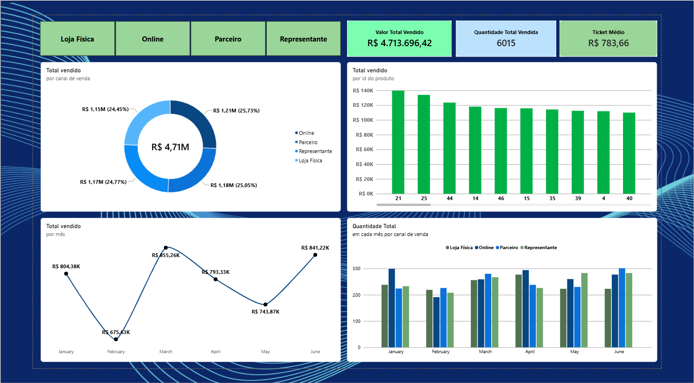

<div align="center">
  <h1>Dashboard de Vendas Multicanal</h1>
  <h3>Análise de Desempenho Comercial do 1º Semestre para Otimização Estratégica do 2º Semestre.</h3>
  <p>Transformação de dados históricos em ações futuras.<br/><b>KPIs Executivos. Visão Omnichannel.</b></p>

  <p>
    <a href="#overview">Visão Geral</a> ·
    <a href="#dataset">Estrutura dos Dados</a> ·
    <a href="#kpis">Indicadores Chave</a> ·
    <a href="#insights">Insights Críticos</a> ·
    <a href="#architecture">Arquitetura & Stack</a> ·
    <a href="#trade-offs">Trade-offs</a>
  </p>

  <!-- Badges -->
  <p>
    
    
    
  </p>

  <!-- Screenshot Principal do Dashboard -->
  
</div>

> **Olhar apenas para o faturamento total esconde os gargalos operacionais.** Enquanto o acumulado do semestre aparenta estabilidade, uma análise granular revela assimetrias importantes de ticket médio e sazonalidade entre os canais de distribuição que ditam o planejamento para o segundo semestre.

---

## 📸 Visão em Ação

<table>
  <tr>
    <td align="center" width="50%">
      
      <br/><b>Visão Executiva (KPI Cards)</b><br/>
      <sub>Faturamento Total, Volume de Vendas e Ticket Médio consolidado.</sub>
    </td>
    <td align="center" width="50%">
      
      <br/><b>Desempenho por Canal</b><br/>
      <sub>Comparativo dinâmico de performance mês a mês entre as frentes Online, Loja Física, Parceiros e Representantes.</sub>
    </td>
  </tr>
</table>

## 🏗️ Arquitetura do Projeto & Pipeline de Dados

```text
┌────────────────────────────────────────────────────────────────────┐
│  Fonte de Dados Transacionais (Base CSV / Power Query)             │
├────────────────────────────────────────────────────────────────────┤
│  1. Ingestão & Tratamento Inicial ➔ Tipagem e Correção monetária  │
├──────────────────────────┬─────────────────────────────────────────┤
│  Visualização Executiva  │  Entregáveis de Negócio                 │
│  • Cartões de KPIs       │  • Diagnóstico do 1º Semestre           │
│  • Gráficos Temporais    │  • Subsídio para Metas do 2º Semestre   │
│  • Sazonalidade por Canal│  • Otimização Orçamentária por Canal    │
└──────────────────────────┴─────────────────────────────────────────┘
```

---

## 📊 Estrutura e Diagnóstico dos Dados (`base_Modulo01.csv`)

O projeto baseia-se em um conjunto de dados transacionais limpo e estruturado contendo **2.000 registros** de vendas. Abaixo estão as principais características estatísticas extraídas da base:

* **Volume de Transações:** 2.000 vendas registradas ao longo do período.
* **Faturamento Total Analisado:** ~R$ 4.713.696,42 (com média de R$ 2.356,85 por transação).
* **Ticket Médio Consolidado:** R$ 783,66 por item.
* **Canais de Venda Mapeados:** Distribuição equilibrada entre *Online*, *Loja Física*, *Parceiro* e *Representante*  no semestre (girando em torno de 24% a 25% de representatividade individual cada).

---

## 🔍 Principais Insights Extraídos da Análise

1. **Equilíbrio de Canais (Omnichannel Sólido):**
* *Diagnóstico:* Diferente de estruturas comuns onde um único canal responde por 70%+ das vendas, a operação apresenta altíssima maturidade na distribuição multicanal, com faturamento muito bem distribuído entre os 4 pilares.
* *Ação Prática:* Evita dependência de risco único, mas exige estratégias de margem diferenciadas, visto que os custos operacionais de cada canal variam.


2. **Comportamento de Sazonalidade:**
* *Diagnóstico:* O 1º semestre apresentou flutuações claras de volume, com picos expressivos em meses específicos (como março e junho) e contrações em períodos intermediários.
* *Ação Prática:* O time comercial do 2º semestre deve antecipar campanhas de estoque e marketing com base nos meses de baixa histórica mapeados no relatório.


3. **Oportunidade no Ticket Médio:**
* *Diagnóstico:* Com um desvio padrão relevante no valor unitário e total das vendas, há espaço para estratégias agressivas de *Cross-selling* e *Up-selling* para elevar o ticket médio atual de R$ 783,66.


---

## ⚖️ Trade-offs de Engenharia e Design no Power BI

Ao construir este projeto, decisões conscientes foram tomadas para equilibrar performance visual e rigor técnico:

| Aspecto | Decisão de Design | Trade-off Assumido |
| --- | --- | --- |
| **Granularidade da Base** | Uso direto de tabela transacional otimizada via Power Query. | **Flexibilidade vs Complexidade:** Modelo simplificado para foco na entrega visual rápida, dispensando tabelas de dimensões complexas desnecessárias para o escopo. |
| **Paleta de Cores e UI** | Cores sóbrias e alinhadas ao design corporativo moderno (Fluent UI). | **Estética Limpa:** Abandono de excessos visuais em prol de uma leitura executiva limpa e sem ruídos cognitivos. |
| **Uso de Medidas Explícitas** | Criação de métricas de negócio dedicadas em DAX em vez de cálculos implícitos. | **Rigor Analítico:** Garante consistência nos cálculos de faturamento e ticket médio independentemente dos filtros cruzados aplicados. |

---

## 📄 Licença

Este projeto é distribuído sob a licença **MIT**. Sinta-se livre para utilizá-lo, estudá-lo e adaptá-lo para o seu portfólio profissional.
